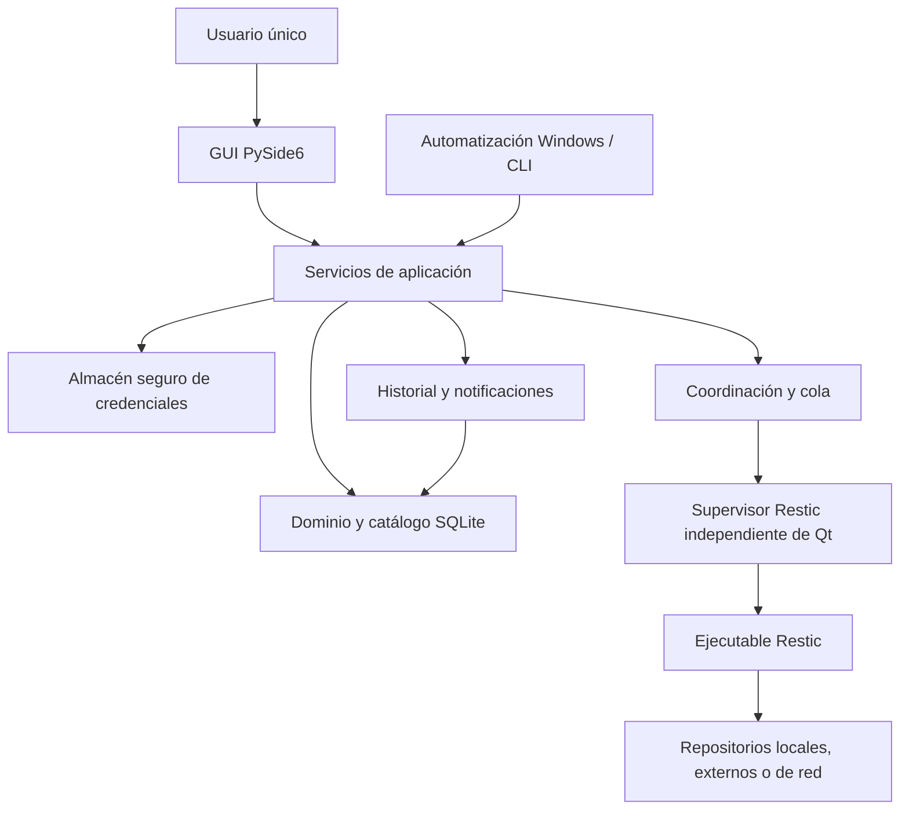

# Restic Desktop — Diseño consolidado y hoja de ruta del MVP

> **Actualización de autoridad.** La solicitud posterior del propietario autoriza implementar el MVP, actualizar la documentación y publicar en la rama de desarrollo. Las restricciones de autorización histórica de este documento se conservan como contexto y quedan sustituidas por esa solicitud. Las tareas reales y repositorios personales requieren autorización específica.


**Versión del documento:** 1.0
**Fecha de consolidación:** 24 de noviembre de 2026
**Estado:** requisitos de producto definidos; evaluación inicial del código reportada; implementación pendiente de autorización.
**Repositorio:** <https://github.com/barucsinfiltros/restic-desktop>
**Rama de desarrollo:** `codex/initial-restic-foundation`
**Commit de referencia de la evaluación de Codex:** `2b63b6602ec56272154a4da1d3b507227155b6cc`
**Upstream:** [Dallustallus/restic-desktop](https://github.com/Dallustallus/restic-desktop), base histórica `d2f258f99a56f8b40a4cd10f75e0bc2727cfc065`.

## 1. Propósito y autoridad del documento

Este documento consolida las seis rondas de definición del producto (72 respuestas), el contexto maestro previo y el informe de evaluación de Codex aportado por el propietario. Su propósito es servir como especificación rectora para orientar implementación, pruebas y auditorías, evitando repetir el diseño y consumir recursos en funcionalidades innecesarias.

Se distinguen cuatro categorías:

- **Aprobado:** requisito u orientación elegida explícitamente por el propietario.
- **Propuesto:** solución técnica, prioridad o criterio de aceptación recomendado; no equivale a autorización de implementación.
- **Pendiente:** detalle que debe resolverse antes de habilitar la operación correspondiente.
- **Reportado:** estado del código o pruebas comunicado por Codex o por el contexto histórico; no constituye verificación independiente de esta conversación.

Las decisiones más recientes del propietario prevalecen sobre los requisitos incompatibles del diseño anterior. La documentación histórica del repositorio no se considera actualizada por la creación de este archivo. No se autoriza modificar código, documentación del repositorio, tareas del sistema, repositorios de respaldo ni implementar el antiguo esquema v2 de importación.

## 2. Visión y alcance aprobados

Restic Desktop es una aplicación de escritorio para administrar respaldos personales de carpetas sin crear ni mantener un script distinto para cada origen. Su caso de uso principal son instalaciones, perfiles y mundos de Minecraft, aunque debe funcionar con cualquier carpeta compatible: documentos, proyectos, fotografías y otras aplicaciones.

El propietario es el único usuario previsto en su equipo. Puede publicarse para otros usuarios en el futuro, pero cada instalación seguirá siendo personal; no se necesita un sistema de cuentas, roles o autenticación propia.

### 2.1. Experiencia objetivo

1. Abrir la aplicación y crear un perfil seleccionando una carpeta.
2. Crear o registrar un repositorio Restic existente y guardar sus credenciales de forma segura.
3. Asociar el perfil a uno o varios repositorios.
4. Configurar exclusiones y, cuando esté disponible, una programación por destino.
5. Respaldar manualmente o dejar que el programa realice el trabajo automáticamente.
6. Consultar resultados, errores, snapshots e historial sin utilizar comandos.
7. Recuperar archivos o una carpeta completa de manera segura.

El éxito se mide por la facilidad y fiabilidad de este flujo, no por la sofisticación de la arquitectura.

### 2.2. Principios

- Reutilizar el código funcional del fork y mantener historial, licencia MIT y atribuciones correspondientes.
- Restic es el motor de respaldo: no duplicar su cifrado, deduplicación, almacenamiento, exploración ni mecanismos de integridad.
- Priorizar seguridad de los datos, simplicidad, mantenibilidad y desarrollo incremental.
- No presentar como exitosas operaciones parciales, fallidas o sin evidencia suficiente.
- No confundir eliminar una configuración local con eliminar respaldos físicos.
- No agregar dependencias, abstracciones o infraestructura sin una necesidad concreta.
- Mantener las operaciones destructivas bajo confirmación explícita o una política previamente autorizada.

### 2.3. Fuera del alcance inicial

No se requieren cuentas, autenticación propia, roles, servidor SQL, API web, microservicios, sincronización activa entre equipos, auditoría empresarial, linaje avanzado, lotes de importación heredada, sincronización JSON/SQLite, integración de almacenamiento en nube, despertar o encender el PC automáticamente, reintentos automáticos no autorizados ni limitadores avanzados de CPU, memoria o disco. No se necesita instalador ni actualizador automático para la primera versión. La portabilidad futura no obliga a dar soporte oficial inmediato a Linux o macOS.

## 3. Arquitectura

### 3.1. Stack aprobado

| Componente | Elección |
|---|---|
| Plataforma prioritaria | Windows 11 |
| Lenguaje | Python |
| GUI | PySide6 |
| Motor de respaldos | Restic |
| Persistencia local | SQLite, catálogo simplificado |
| Credenciales | Almacén seguro del sistema operativo |
| Automatización | Ejecutor independiente de GUI e integración con Windows |
| Idioma inicial | Español |
| Distribución inicial | Ejecución directa desde Python |
| Actualizaciones | Manuales mediante GitHub |

SQLite almacena configuración, relaciones e historial, no los archivos respaldados. Es una base local sin servidor independiente; sus transacciones ayudan a mantener coherencia entre GUI y ejecutores. Restic conserva la autoridad sobre el contenido real y los snapshots de sus repositorios.

### 3.2. Componentes y responsabilidades



La GUI presenta estados y solicita operaciones; no debe contener las reglas centrales ni depender de señales incompletas para declarar éxito. El dominio y los servicios validan entidades, asociaciones, exclusividad, rutas y operaciones. La persistencia garantiza integridad y concurrencia. El supervisor ejecuta Restic, captura stdout/stderr, conserva PID y estado, progreso, cancelación, timeout, terminación y resultado observado. La solicitud de cancelación o timeout no demuestra que el proceso terminó; no liberar coordinación hasta comprobar su finalización.

La automatización debe reutilizar los servicios de aplicación y no introducir un segundo motor de respaldos. Debe funcionar aunque se cierre la GUI. La implementación concreta de eventos, ejecución independiente y coordinación entre procesos está pendiente; no se exige un servicio permanente privilegiado si existe una alternativa más sencilla.

## 4. Catálogo, perfiles y repositorios

### 4.1. Reglas aprobadas

- Cada perfil representa **una única carpeta de origen** y posee un UUID estable, independiente de su nombre y ruta.
- Cada perfil puede asociarse a varios repositorios; la configuración de exclusiones pertenece al perfil y la programación y los resultados son independientes por asociación perfil–repositorio.
- Un repositorio tiene UUID estable y una única ubicación activa. Puede ser compartido por varios perfiles o exclusivo de uno.
- Los destinos admitidos inicialmente son discos locales, discos externos y carpetas de red. No identificar un repositorio exclusivamente por su ruta o letra de unidad.
- Crear repositorios nuevos y registrar repositorios Restic existentes sin destruir ni modificar sus snapshots por el mero registro.
- Desregistrar un repositorio no elimina sus datos físicos.
- Rechazar la conversión de compartido a exclusivo mientras existan asociaciones incompatibles; resolverlas explícitamente antes de continuar.
- Las transferencias de propiedad y cambios de exclusividad deben ser explícitos y transaccionales.
- Archivar un perfil conserva UUID, nombre e historial; elimina su configuración operativa y asociaciones, sin borrar respaldos. Antes de archivar al propietario de un repositorio exclusivo, resolver explícitamente la propiedad, incluso en estados como `pending_init`.
- Clonar un perfil crea un UUID nuevo; reutiliza repositorios compartidos, pero no asigna los exclusivos del original. Si solo tenía destinos exclusivos, queda sin destino hasta que el usuario seleccione uno.
- Etiquetar los snapshots nuevos con una etiqueta estable derivada del UUID del perfil, no del nombre o ruta.
- Los snapshots creados fuera de la aplicación pueden explorarse y restaurarse sin asignarlos automáticamente a perfiles.

### 4.2. Modelo conceptual propuesto (no DDL aprobado)

| Entidad lógica | Datos/responsabilidad |
|---|---|
| Perfil | UUID, nombre, estado, carpeta única, exclusiones, aplicaciones bloqueantes y configuración aplicable |
| Repositorio | UUID, nombre, localizador activo, tipo, identidad verificada, exclusividad/propietario, referencia a credencial |
| Asociación perfil–repositorio | Referencias, programación, política aplicable, estado operativo y orden si resulta útil |
| Programación | Intervalos, horarios y eventos; próxima ejecución y marcas de evaluación |
| Intento de operación | Identidad de perfil y repositorio, origen manual/automático, tiempos, resultado, evidencia, snapshot si existe |
| Configuración general | Preferencias, límite de concurrencia, notificaciones, referencia de instalación y opciones de inicio |

Estas entidades son responsabilidades lógicas; no obligan a crear una tabla por cada una. Aprovechar el modelo existente cuando sea suficiente. No duplicar en SQLite el inventario completo de archivos o snapshots de Restic.

### 4.3. Persistencia y credenciales aprobadas

Priorizar durabilidad, restricciones de integridad, transacciones, revisiones y rechazo de escrituras obsoletas cuando corresponda. Mantener una única fuente operativa de configuración después de activar el catálogo. No introducir el antiguo esquema v2 de importación y linaje.

El almacén seguro del sistema operativo conservará las contraseñas de repositorios y demás secretos necesarios. SQLite solo debe guardar referencias no secretas. Los ejecutores automáticos deben operar bajo una identidad que pueda recuperar las credenciales correctas. Nunca exponer secretos en argumentos innecesarios, logs, errores, exportaciones ni informes.

Registrar de forma sencilla usuario local del sistema, identificador de instalación y origen de ejecución (GUI, CLI, automatización); esto no supone crear usuarios propios ni un sistema de auditoría empresarial.

**Detalles técnicos pendientes:** esquema mínimo definitivo, formato de etiqueta UUID, política SQLite de sincronización/journal y respaldo consistente, integración concreta con almacén seguro de Windows, verificación de identidad de repositorios y rutas, reglas de cambio de carpeta y credenciales, y retención de historial. Proponer solo cambios necesarios y comprobar su impacto antes de aplicarlos.

## 5. Transición desde el fork y activación segura

### 5.1. Decisión vigente

No se requiere importar configuraciones JSON de upstream. Se comenzará con un catálogo limpio y se permitirá registrar repositorios Restic existentes. Se elimina del alcance la migración compleja de registros heredados, linaje, sellado de lotes, persistencia de decisiones de importación y sincronización permanente JSON/SQLite.

Esta decisión reemplaza el requisito previo de migrar configuraciones heredadas, pero no elimina la necesidad de neutralizar ejecutores antiguos ni proteger los archivos existentes. El catálogo limpio no significa borrar JSON, historial ni respaldos del usuario.

### 5.2. Barrera de activación propuesta

1. Inventariar todas las rutas que puedan iniciar Restic: GUI, CLI, tareas programadas, retención, mantenimiento y ejecutores genéricos.
2. Identificar tareas heredadas y cuentas de ejecución; detectar trabajos activos y conflictos con otras instancias.
3. Proponer cómo deshabilitar o sustituir tareas antiguas de manera verificable. Su modificación real requiere autorización específica.
4. Impedir que se habiliten operaciones del catálogo mientras persista una ruta heredada incompatible o un conflicto no resuelto.
5. Activar el catálogo como fuente única de verdad y verificar que las operaciones nuevas resuelvan destinos por UUID, no por nombres.
6. No eliminar código, datos o tareas automáticamente; determinar dependencias y conservar evidencia de la transición.

Una primera entrega puede preparar el catálogo y las pantallas usando datos temporales, sin habilitar respaldos reales. No afirmar que una barrera interna controla herramientas Restic externas que no cooperan con ella.

## 6. Respaldos y coordinación

### 6.1. Contrato funcional aprobado

| Situación | Comportamiento |
|---|---|
| Respaldo manual | Solo por solicitud explícita del usuario |
| Respaldo automático | Según programación y condiciones de cada asociación |
| Sin cambios comprobados | Omitir snapshot automático y registrar comprobación válida |
| Incertidumbre sobre cambios | Ejecutar respaldo en lugar de omitirlo |
| Repositorio no disponible | Registrar estado y continuar con otros destinos |
| Repositorio reconectado | Esperar la siguiente programación, sin disparo por reconexión |
| Concurrencia por repositorio | Máximo un respaldo activo |
| Concurrencia global | Configurable, inicialmente uno |
| Límite ocupado | Encolar sin duplicados |
| Solicitud duplicada para destino activo | Mostrar ejecución existente; no iniciar otra |
| Archivos no legibles | Conservar snapshot parcial si existe y mostrar incompleto |
| Error inesperado | No reintentar sin autorización |
| Siguiente programación después de fallo | Puede ejecutarse normalmente; no es un reintento inmediato |
| Controles de recursos | No incorporar limitadores inicialmente |

Los resultados de varios destinos son independientes; un fallo no oculta el éxito de otro. La interfaz no debe presentar el perfil completo como totalmente protegido si alguno de sus destinos requeridos no se respaldó.

### 6.2. Flujo propuesto de una operación

Resolver perfil y destino por UUID; comprobar estado operativo, identidad y disponibilidad del repositorio, credenciales, ruta de origen y exclusiones; comprobar bloqueos y coordinación; ejecutar mediante el supervisor; registrar evidencia, resultado y snapshot confirmado; actualizar historial y programación; aplicar retención solo si corresponde y es segura.

Revalidar condiciones después de esperar en cola. No crear automáticamente un repositorio vacío en una ruta donde se esperaba un disco desconectado o un repositorio distinto. La detección de cambios debe aprovechar Restic cuando sea posible, no basarse solo en tamaño, fecha de carpeta o número de archivos. Una comprobación sin cambios solo es válida si se refiere a una base completa y pertinente para esa asociación; no se presume que un snapshot parcial equivale a una base completa.

### 6.3. Estados y evidencia (propuesta)

Distinguir al menos: pendiente/en cola, esperando aplicación, ejecutando, éxito completo, sin cambios comprobados, incompleto, fallido, cancelado/interrumpido, no disponible y desconocido cuando no hay evidencia suficiente. Los nombres exactos y las transiciones se decidirán según el contrato del supervisor existente.

Registrar intento, tiempos, destino, origen de ejecución, resultado observado, salida relevante sanitizada, identificador de snapshot cuando exista y motivo de omisión o error. El código de salida por sí solo no demuestra que todos los datos previstos quedaron respaldados. La cancelación solicitada no debe confundirse con finalización. Coordinar también restauración y mantenimiento que sean incompatibles con otras operaciones sobre el repositorio.

## 7. Automatización Windows

### 7.1. Programación aprobada

- Inicio de la aplicación minimizado en la bandeja al iniciar Windows/sesión, según el mecanismo viable para la cuenta local.
- Intervalos, horarios y eventos: inicio de sesión, cierre de aplicaciones seleccionadas y reanudación desde suspensión.
- Intervalos calculados desde el último respaldo completo exitoso o la última comprobación válida sin cambios. Conservar por separado la fecha del último snapshot exitoso y de la última comprobación.
- Si el PC estuvo apagado durante varias ejecuciones, consolidar en una única ejecución pendiente por asociación al volver a estar disponible.
- Si el destino está desconectado en una ejecución, esperar la siguiente programación; no hacer recuperación inmediata al reconectar.
- Configurar aplicaciones bloqueantes por perfil; si están abiertas, posponer el respaldo automático hasta su cierre.
- Permitir respaldo manual pese al bloqueo solo con advertencia y confirmación explícita. No afirmar que respaldar un mundo abierto garantiza coherencia de la aplicación.
- No despertar ni encender el equipo automáticamente.
- Permitir solicitar manualmente apagado tras finalizar trabajos; cancelar y notificar si algún respaldo falla.
- Notificar errores y advertencias por defecto, éxitos opcionales.
- Pulsar X cierra la interfaz cuando no haya respaldos activos; durante respaldos activos, impedir cierre normal. Esto sustituye la propuesta de minimizar siempre al pulsar X.
- El ejecutor automático debe seguir disponible aunque la GUI se haya cerrado. Un apagado forzado o fallo del proceso debe poder detectarse y reflejarse en el historial.

### 7.2. Ejemplo de intervalos

Si una asociación tiene intervalo de dos horas y obtiene un respaldo completo a las 14:00, la siguiente evaluación corresponde a las 16:00. Si a las 16:00 se comprueba válidamente que no hay cambios, la siguiente será a las 18:00, manteniendo las 14:00 como fecha del último snapshot completo.

### 7.3. Detalles técnicos pendientes

Definir una política de próximo vencimiento que evite bucles de ejecución tras fallos o desconexiones, aunque la fecha de último éxito permanezca intacta. Determinar comportamiento antes del primer éxito, deduplicación de eventos simultáneos, detección fiable de procesos bloqueantes, reanudación de trabajos en cola y alcance exacto del apagado solicitado (recomendación: no apagar ante resultados incompletos, cancelados o pendientes no satisfechos). Distinguir cierre de ventana, salida completa y apagado del sistema. Seleccionar el mecanismo Windows más simple que cumpla la ejecución independiente y las credenciales de la cuenta correcta.

## 8. Exploración y restauración segura

### 8.1. Requisitos aprobados

- Explorar y restaurar snapshots completos, carpetas y archivos individuales.
- Mostrar fecha, hora, repositorio, archivos, tamaño y estado del respaldo cuando exista evidencia; si no, mostrar desconocido.
- Permitir snapshots externos sin asociación automática al perfil; permitir snapshots incompletos con advertencia explícita sobre posibles archivos ausentes.
- Ubicación original como destino predeterminado del producto completo cuando sea conocida y válida; permitir destinos alternativos.
- Antes de modificar la ubicación original, crear un respaldo de seguridad completo de los datos existentes; cancelar si falla, queda incompleto o no puede verificarse suficientemente.
- Bloquear restauración al origen mientras estén abiertas las aplicaciones bloqueantes; no reutilizar la excepción manual de backup para restaurar.
- Sobrescribir solo archivos diferentes. Para una restauración completa exacta sobre el origen, retirar también los archivos adicionales que no pertenezcan al snapshot, previa protección y confirmación explícita.
- Verificar resultado y archivos restaurados con los mecanismos de integridad disponibles. Mantener una vía de recuperación ante interrupciones.

### 8.2. Distinción entre modalidades

| Modalidad | Comportamiento |
|---|---|
| Destino alternativo vacío | Primera entrega recomendada; no modifica la carpeta original |
| Restauración selectiva al origen | Recupera archivos/carpetas seleccionados; no implica borrar archivos ajenos a la selección |
| Restauración completa exacta al origen | Recupera el contenido del snapshot y retira extras dentro del alcance autorizado |

La última decisión sobre restauración exacta reemplaza la propuesta anterior de conservar siempre archivos adicionales. Restaurar un snapshot incompleto de forma exacta puede retirar archivos ausentes por un fallo del respaldo, por lo que requiere advertencia específica; no se debe habilitar esta combinación hasta definir una confirmación y protección suficientes.

### 8.3. Flujo seguro propuesto para restauración al origen

1. Identificar de forma inequívoca repositorio, snapshot y alcance.
2. Validar destino, espacio disponible, aplicaciones activas y rutas/puntos de reanálisis (enlaces, junctions, etc.).
3. Presentar vista previa de los archivos que se modificarían o retirarían y solicitar confirmación.
4. Coordinar exclusión de operaciones incompatibles, crear respaldo de seguridad y verificar resultado antes de tocar el origen.
5. Preparar restauración mediante staging u otra estrategia recuperable si resulta necesaria; revalidar condiciones antes y durante la ejecución según el mecanismo seleccionado.
6. Ejecutar, verificar archivos y comprobar exactitud cuando esa modalidad se solicite.
7. Registrar el resultado y preservar la recuperación ante fallos o interrupciones.

No afirmar que existe confinamiento de escrituras solo porque se validó la ruta antes de lanzar Restic. La implementación de restauración original permanece deshabilitada hasta demostrar su seguridad. El destino de la copia de seguridad, su protección frente a retención, el procedimiento de recuperación, los límites de rutas y la semántica de verificación son detalles pendientes que bloquean habilitar restauraciones destructivas, no bloquean el primer MVP en destinos vacíos.

## 9. Retención, mantenimiento e integridad

### 9.1. Decisiones aprobadas

- Conservar los últimos N respaldos y permitir políticas diarias, semanales y mensuales.
- Aplicar retención automáticamente después de un respaldo completo y exitoso, según una política autorizada.
- Proteger el último respaldo completo válido. Un snapshot parcial no debe provocar su eliminación.
- Limitar la retención a los snapshots del perfil correspondiente dentro del repositorio compartido; no afectar snapshots externos o de otros perfiles por inferencias de nombre/ruta.
- `prune` manual o mediante mantenimiento programado independiente del respaldo. No ejecutarlo obligatoriamente después de cada eliminación.
- Comprobación de integridad manual desde la interfaz para el MVP.

### 9.2. Garantías técnicas propuestas

Separar eliminación lógica de snapshots (`forget`) y recuperación de espacio (`prune`); mostrar su impacto y exigir autorización manual o política explícita. Proteger también las copias necesarias para recuperar restauraciones. No clasificar como completo un snapshot cuyo resultado no consta. Mostrar plan de retención antes de aplicar una nueva política y validar el conjunto exacto que puede eliminarse. Coordinar mantenimiento con respaldos/restauraciones y respetar los bloqueos de Restic.

**Pendiente:** alcance exacto de la política (por perfil y/o asociación, recomendación: resolver por asociación para cada destino), valores por defecto y combinación de reglas temporales, tratamiento de snapshots parciales/desconocidos, duración de protección de copias de seguridad y contrato de recuperación tras errores de `forget`/`prune`. No imponer una retención destructiva por defecto sin autorización.

## 10. Recuperación del catálogo y cambio de equipo

Requisitos aprobados: exportación portable de configuración, perfiles, repositorios e historial sin credenciales; transferencia conservando UUID y revalidando rutas y contraseñas antes de activar; respaldos automáticos versionados del catálogo, recuperación explícita y reconstrucción asistida como último recurso.

La transferencia de catálogo no copia automáticamente los datos físicos Restic ni sincroniza dos equipos. Si se pierde el catálogo, los repositorios pueden seguir existiendo y ser registrados de nuevo. No inventar historial, estado de completitud ni asignaciones de snapshots al reconstruirlo.

Propuesta: mecanismo sencillo de exportación versionada y restauración consistente del catálogo, con importación validada antes de activar trabajos. Evitar incluir secretos de manera indirecta en rutas, logs o metadatos. Definir periodicidad y ubicación de respaldos, compatibilidad de versiones y prevención de activación accidental de dos instalaciones sobre el mismo destino. Los mecanismos básicos de respaldo consistente del catálogo son necesarios desde las primeras escrituras reales; la interfaz completa de transferencia y reconstrucción puede esperar.

## 11. Interfaz y distribución

### 11.1. Requisitos aprobados

- Español inicialmente; tema claro y oscuro siguiendo Windows.
- Crear perfiles mediante opciones esenciales visibles y una sección avanzada.
- Ejecutar desde Python hasta estabilizar la aplicación; actualizaciones manuales mediante GitHub.
- Inicio minimizado en bandeja y notificaciones según el apartado de automatización.

### 11.2. Pantallas y experiencia propuestas

| Pantalla | Contenido mínimo |
|---|---|
| Inicio / perfiles | Lista de carpetas, estado por destino, último resultado, próxima ejecución, respaldar, explorar, editar |
| Alta/edición de perfil | Nombre, carpeta única, destinos; exclusiones y opciones avanzadas cuando estén habilitadas |
| Repositorios | Crear, registrar, comprobar disponibilidad, configurar credenciales, compartir/exclusividad, desregistrar |
| Progreso y cola | Estado real por operación, destino, progreso si está disponible, errores y cancelación supervisada cuando se implemente |
| Snapshots | Fecha, repositorio, identidad y estado conocido, explorador y acciones de restauración |
| Historial | Intentos manuales/automáticos, resultados, motivos y evidencia sanitizada |
| Configuración | Inicio, notificaciones, concurrencia, catálogo y mantenimiento según disponibilidad |

No presentar botones operativos que invocan rutas heredadas incompatibles ni opciones no implementadas como funcionales. Priorizar reutilización de componentes visuales upstream. Las características de interfaz no esenciales pueden pulirse después de completar el flujo de respaldo y recuperación.

## 12. Estado de la implementación (informe de Codex aportado por el propietario)

La evaluación reportada corresponde a `codex/initial-restic-foundation` en `2b63b6602ec56272154a4da1d3b507227155b6cc`. Codex indica árbol versionado limpio y `.codex/` sin seguimiento. No se ha verificado independientemente ese SHA, sus líneas ni si existe un HEAD posterior. Las referencias siguientes son las comunicadas en el informe, no resultados de una nueva auditoría.

| Área | Estado reportado | Referencia del informe |
|---|---|---|
| Catálogo | Parcial: UUID, asociaciones, exclusividad y revisiones; servicio solo en `staged`, GUI/CLI aún usan JSON | `core/catalog_service.py:32`, `core/catalog_storage.py:214` |
| Esquema | Una asociación conserva posición pero no programación ni resultados independientes; perfil admite varias carpetas; archivado conserva asociaciones | `core/catalog_storage.py:15` |
| Alta de repositorio | Formulario existente reutilizable, todavía ligado a configuración heredada | `restic_manager.py:5964` |
| Respaldo manual | GUI utiliza supervisor, pero resuelve asociaciones por nombres | `restic_manager.py:12451` |
| Etiquetas | Derivadas de nombre del trabajo, no UUID del perfil | `restic_manager.py:1978` |
| Supervisor e historial | Distingue éxito, fallo e incompleto; historial por nombres, requiere referencias UUID para nuevos intentos | `core/restic_supervisor.py:299`, `core/history_db.py:71` |
| Exploración y restauración | Consulta snapshots y restaura a carpeta alternativa vacía; restauración al origen deshabilitada | `restic_manager.py:6819`, `restic_manager.py:11253` |
| Credenciales | Gestión heredada; falta integrar almacén seguro del SO al nuevo flujo | `restic_manager.py:1234` |
| Automatización y retención | Parciales; algunas tareas ejecutan Restic directamente y no consultan catálogo | `restic_manager.py:4412`, `restic_manager.py:13539` |
| Límites de restauración | Protección actual reduce carreras pero no confina completamente escrituras de Restic | `DOCS/INITIAL_FOUNDATION.md` |

Codex recomienda conservar supervisor, adaptador de progreso, validaciones de catálogo y exploración existente. El SQLite actual sirve de base, pero requiere ajustes acotados para el producto. No es necesario adoptar el esquema v2 de importación y linaje según esa evaluación; cualquier cambio de esquema ordinario deberá diseñarse y aprobarse por separado.

### 12.1. Pruebas reportadas

```powershell
env\Scripts\python.exe -B -m unittest discover -s tests -q
```

Codex informa **95 pruebas aprobadas y una omitida**, debido al permiso de Windows para crear enlaces simbólicos (error 1314). Informa que no realizó pruebas con repositorios Restic reales ni modificó archivos del proyecto. Estos resultados no fueron reproducidos en esta conversación y no demuestran por sí solos que el MVP esté integrado. Debe cubrirse el caso omitido en un entorno de pruebas que permita enlaces simbólicos cuando se valide la restauración correspondiente.

### 12.2. Contexto histórico relevante

El documento maestro identificaba el catálogo en `staged`, el importador de solo lectura `core/catalog_import.py`, y pruebas en `tests/test_catalog.py` y `tests/test_catalog_import.py`. El importador fue objeto de correcciones de clasificación de secretos, JSON, SFTP y representación visible. La última auditoría histórica del plan de importación (mismo SHA de referencia) dejó aprobación condicionada por semántica de revisiones/lotes, garantías relacionales y durabilidad SQLite. Los primeros dos hallazgos eran específicos del diseño de importación que ahora queda fuera de alcance; no deben declararse corregidos, sino reevaluados según el nuevo producto. La durabilidad y las invariantes del catálogo siguen siendo relevantes.

## 13. Alcance y camino más corto al MVP

La siguiente priorización es una propuesta de ejecución, no una revocación de requisitos aprobados. Se debe adelantar cualquier componente ya funcional y seguro cuando reduzca trabajo, sin forzar reescrituras.

### 13.1. MVP 1 — Primera versión utilizable

- Catálogo limpio, perfiles de carpeta única, repositorios y asociaciones, archivado según nueva regla.
- GUI integrada al catálogo, alta/registro de repositorios, credenciales seguras y verificación de destinos.
- Respaldo manual por asociación, exclusiones, etiqueta UUID, progreso, resultado e historial por destino.
- Coordinación mínima necesaria para prevenir duplicados y ejecutores incompatibles antes de usar datos reales.
- Explorar snapshots y restaurar a una carpeta alternativa vacía con verificación.
- Respaldo básico consistente del catálogo y ejecución desde Python.

En esta entrega, la restauración al origen y cualquier ruta de retención automática no segura deben permanecer deshabilitadas. La restauración alternativa vacía es una limitación temporal explícita, no un cambio de la decisión de destino original por defecto del producto final.

### 13.2. MVP 2 — Automatización y uso cotidiano

Programación por intervalos y horarios, cola y concurrencia, detección de cambios, aplicaciones bloqueantes, recuperación de ejecuciones omitidas, inicio/bandeja, notificaciones, restauración original protegida, retención automática segura, comprobación manual de integridad y `prune` manual.

### 13.3. Funciones complementarias aprobadas o previstas

Eventos de sistema adicionales según la secuencia de entrega, apagado solicitado manualmente, mantenimiento programado, exportación/transferencia, recuperación asistida, clonación de perfiles si no está lista, pulido visual y eventual distribución pública. Instalador y soporte oficial adicional son posibilidades futuras, no requisitos del primer MVP.

### 13.4. Hoja de ruta técnica recomendada por Codex

| Orden | Trabajo | Complejidad reportada |
|---|---|---|
| 1 | Preparar catálogo limpio, controlar ejecutores heredados y ajustar carpeta única/asociaciones/archivado | Media |
| 2 | Integrar GUI de perfiles y repositorios, credenciales del sistema y validación de destinos | Alta |
| 3 | Conectar respaldo manual por asociación al supervisor, etiqueta UUID, progreso, resultados e historial | Alta |
| 4 | Explorar snapshots y restaurar a carpeta alternativa vacía, verificando resultados en repositorios temporales | Alta |
| 5 | Completar coordinación, cola y automatización independiente, aplicaciones bloqueantes | Alta |
| 6 | Diseñar y validar restauración al origen con respaldo previo, confirmación y recuperación | Alta |
| 7 | Retención protegida, mantenimiento independiente, exportación y transferencia | Alta |

La coordinación mínima y la barrera frente a ejecutores heredados son requisitos previos a los primeros respaldos reales (pasos 1–3); el paso 5 amplía esa coordinación para automatización y cola. No posponer controles de seguridad imprescindibles hasta después del primer uso.

## 14. Criterios de aceptación y pruebas propuestas

No aceptar una etapa por tener código o pruebas unitarias aisladas. Verificar sus contratos en un entorno temporal y desechable; no utilizar repositorios personales para pruebas destructivas.

| Área | Evidencia de aceptación requerida |
|---|---|
| Catálogo | Un perfil tiene una carpeta; varios destinos válidos; exclusividad y archivado correctos; UUID estables; rollback y rechazo de revisiones obsoletas; restricciones y pruebas SQL directas donde proceda |
| Activación | Inventario de ejecutores; tareas incompatibles identificadas y neutralizadas con autorización; otras instancias controladas; GUI y CLI nuevos no operan con JSON antiguo |
| Credenciales | Recuperación por cuenta correcta; secretos ausentes de registros y exportaciones; error claro si falta acceso |
| Destinos | Disco desconectado, letra reutilizada o repositorio incorrecto no provocan escrituras en destino inesperado |
| Respaldo manual | Flujo GUI completo con Restic temporal; etiqueta UUID correcta; historial por asociación; progreso y resultado observados |
| Resultados | Éxito, fallo, incompleto, cancelación y ausencia de cambios distinguibles; resultado de cada destino independiente |
| Coordinación | No duplicar solicitudes ni sobrepasar límites; no soltar exclusión antes de terminación; bloquear operaciones incompatibles |
| Restauración alternativa | Restaurar archivos y carpetas a destino vacío; verificar contenido; probar destinos no permitidos y puntos de reanálisis; errores sin falsa declaración de éxito |
| Automatización | Ejecución sin GUI; intervalos, horarios, PC apagado/suspendido y aplicaciones bloqueantes; reconexión sin disparo inmediato; no reintentar sin autorización |
| Restauración al origen | No modificar origen si respaldo previo falla; detectar aplicaciones bloqueantes; comprobar exactitud, archivos extra, rutas, interrupciones y recuperación |
| Retención | Política de un perfil no afecta otros ni snapshots externos; último completo protegido; copias de seguridad protegidas; fallo parcial no dispara eliminación indebida |
| Mantenimiento | `prune` independiente; comprobación manual de integridad; errores y coordinación correctamente registrados |
| Recuperación | Respaldo consistente de catálogo; exportación sin secretos; importación valida rutas y credenciales antes de activar; recuperación ante corrupción |
| Interfaz | Flujo sencillo en español; opciones esenciales, estado real, mensajes comprensibles y controles no implementados deshabilitados |

Pruebas adicionales prioritarias: fallos de persistencia, interrupciones de procesos, carreras entre GUI y CLI, bloqueo interproceso, reintentos explícitos, idempotencia donde aplique y pruebas de recuperación. No prometer resistencia absoluta ante fallos de hardware ni confinamiento de escrituras sin evidencia.

## 15. Decisiones sustituidas, pendientes y control de cambios

### 15.1. Sustituidas

| Diseño previo o propuesta | Decisión vigente |
|---|---|
| Aplicación general con potencial multiusuario/empresarial | Uso personal, monousuario; publicación futura no obliga a cuentas propias |
| Importación JSON heredada compleja | Catálogo limpio; conservar respaldos y proteger transición operativa |
| Esquema v2 de linaje y persistencia de decisiones | Fuera del alcance; reevaluar solo ajustes mínimos del esquema actual |
| Perfil con varias carpetas | Una carpeta por perfil |
| Archivado conservando configuración y asociaciones | UUID, nombre e historial; retirar configuración operativa y asociaciones |
| Ejecutar al reconectar un disco | Esperar la siguiente programación |
| Pulsar X siempre minimiza a bandeja | Cerrar GUI si no existen respaldos activos |
| Conservar siempre archivos extra al restaurar | Restauración completa exacta al origen, con respaldo y confirmación |
| Completar arquitectura extensa antes del uso | Obtener un MVP funcional reutilizando lo existente |

### 15.2. Decisiones pendientes que realmente pueden bloquear entregas

| Tema | Momento de resolución |
|---|---|
| Identificar, desactivar o sustituir tareas heredadas bajo distintas cuentas | Antes de activar el catálogo para operaciones reales; requiere autorización específica |
| Ajustes mínimos del esquema y transición/rollback de versiones de catálogo | Antes de implementar cambios persistentes |
| Identidad física de repositorios y coordinación entre instancias | Antes de respaldos reales |
| Mecanismo concreto de credenciales y cuenta de automatización | Antes de conectar operaciones correspondientes |
| Política de durabilidad SQLite y respaldo consistente | Antes de uso persistente real |
| Cálculo de vencimientos tras fallos, desconexión y primera ejecución | Antes de automatización |
| Protocolo de restauración original, protección de copia previa y recuperación | Antes de habilitar restauración al origen |
| Semántica exacta de retención, protección de snapshots desconocidos y de seguridad | Antes de habilitar `forget` automático |
| Formato y estrategia de exportación/importación portable | Antes de implementar transferencia |

No es necesario resolver todos estos temas simultáneamente ni abrir nuevas rondas generales. Presentar la alternativa recomendada y sus consecuencias cuando una decisión arquitectónica o de seguridad bloquee la tarea inmediata. No asumir aprobación por el mero hecho de haberla escrito aquí.

## 16. Siguiente tarea recomendada y límites de autorización

La evaluación reportada recomienda comenzar por el catálogo limpio mínimo y su integración con el alta y selección de perfiles y repositorios. La primera entrega puede operar con datos temporales y sin lanzar Restic. El objetivo es conectar los componentes existentes, no rediseñar todo el proyecto.

Antes de cualquier cambio: comprobar estado de Git y HEAD actual; leer instrucciones aplicables y documentación rectora; identificar diferencias con este documento; proponer ajustes mínimos de esquema y contratos; inventariar dependencias y ejecutores heredados; determinar pruebas y criterios de aceptación. No eliminar el importador automáticamente ni implementar el antiguo esquema v2. Separar la preparación de la barrera de su activación real bajo autorización del propietario.

**La creación de este documento no autoriza implementar, modificar archivos del repositorio, realizar commits o push ni desactivar tareas del sistema.** El siguiente paso deberá aprobarse de forma explícita.

## 17. Metodología de trabajo y auditoría

Flujo: propietario (requisitos y aprobación) → ChatGPT (diseño y dirección técnica) → Codex (implementación autorizada y pruebas) → GitHub (evidencia) → auditoría independiente (aceptación o correcciones).

- Evitar reescrituras y lecturas repetitivas; reutilizar componentes y evidencias verificables.
- En auditoría, trabajar en solo lectura, comprobar rama, SHA, padre y alcance, contrastar código, llamadores, pruebas y diseño vigente.
- Clasificar hallazgos por gravedad (crítico, alto, medio, bajo, informativo), con archivo/líneas, evidencia, impacto, corrección y prueba propuesta.
- Veredictos: aprobado, aprobado con observaciones, aprobación condicionada o rechazado. Diferenciar pruebas inspeccionadas, ejecutadas y reportadas por terceros.
- Mantener información sensible fuera de informes. No ejecutar operaciones destructivas sobre datos personales ni modificar producción.
- Commits y push solo dentro del alcance autorizado; nunca asumir permiso para publicar directamente en `main` o desplegar.
- Priorizar el siguiente flujo funcional comprobable, evitando fases de documentación que no aporten valor práctico.

### Documentos y código de referencia

Los siguientes archivos deben contrastarse con el HEAD real, ya que pueden mantener requisitos históricos sustituidos:

- `DOCS/IMPLEMENTATION_ROADMAP.md`
- `DOCS/INITIAL_FOUNDATION.md`
- `DOCS/PHASE_4_DESIGN.md`
- `DOCS/PHASE_4_IMPORT_PLAN.md` (diseño histórico, no autoridad para implementar linaje)
- `core/catalog_domain.py`, `core/catalog_service.py`, `core/catalog_storage.py`, `core/catalog_import.py`
- `core/restic_supervisor.py`, `core/history_db.py`, `restic_manager.py`, `ui/backup_worker.py`
- `tests/test_catalog.py`, `tests/test_catalog_import.py`, `tests/test_restore_destination.py` y pruebas de CLI, procesos, automatización y persistencia aplicables.

---

**Conclusión:** Restic Desktop debe permitir respaldar y recuperar carpetas personales de forma segura, sin scripts individuales. El diseño general está definido. El trabajo siguiente debe centrarse en integrar el catálogo existente con la interfaz y el supervisor, utilizando primero respaldos manuales y restauración a un destino vacío, y ampliar la automatización y las operaciones destructivas únicamente cuando sus garantías estén demostradas.
