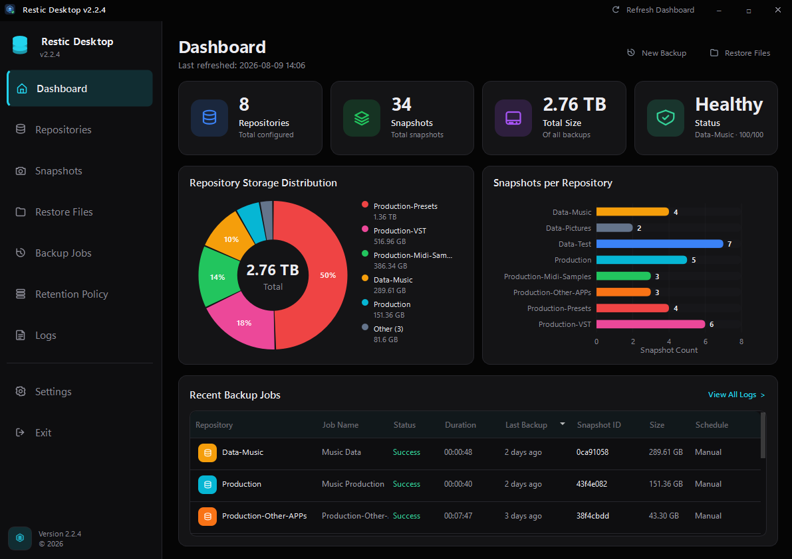
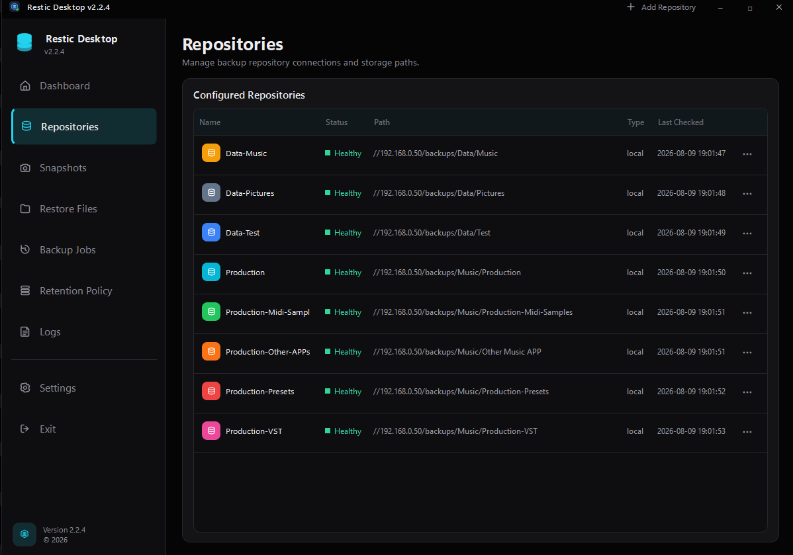
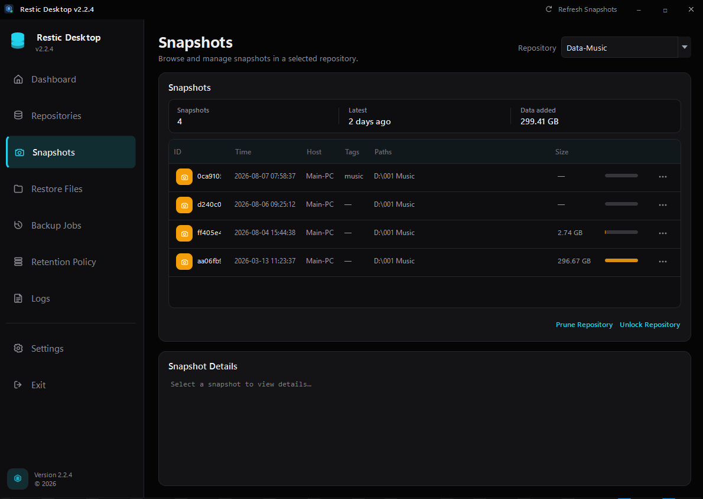
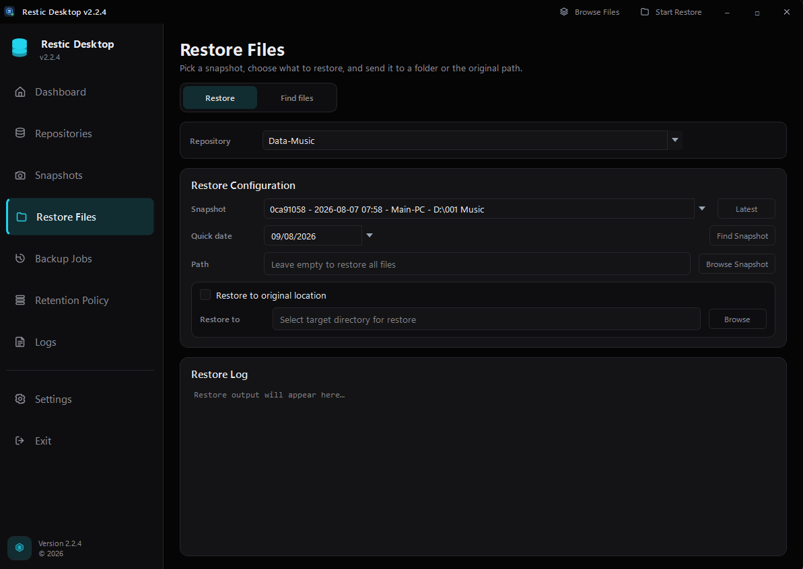
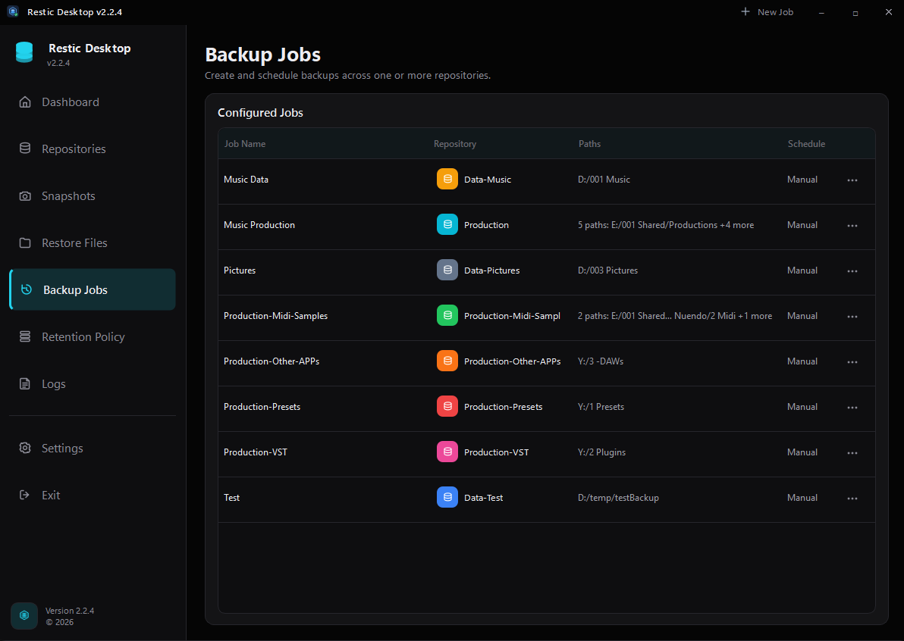
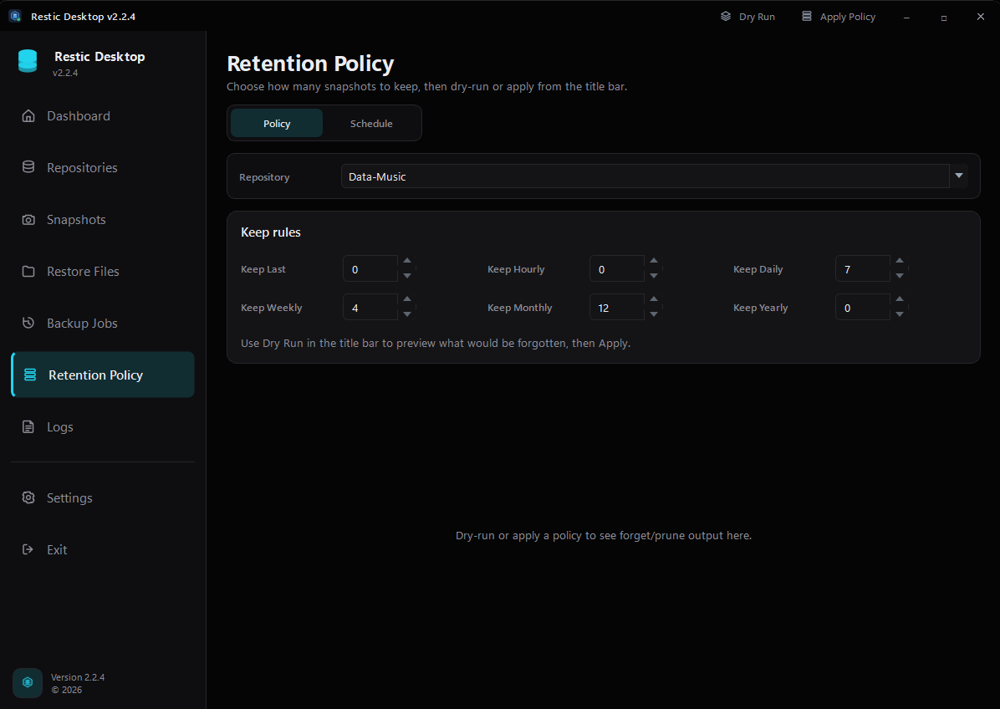
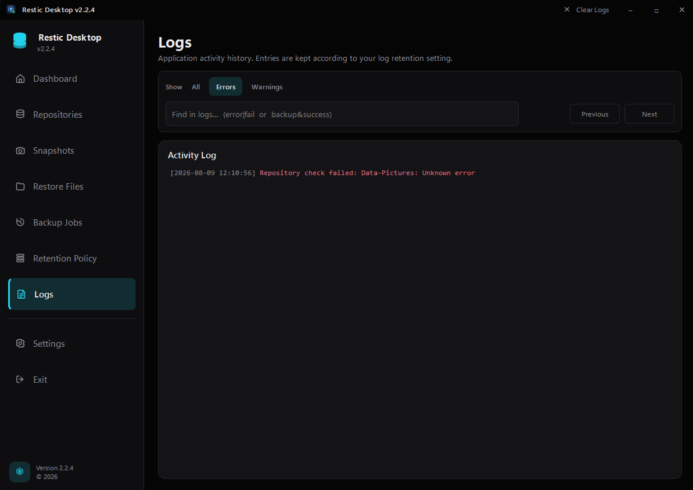
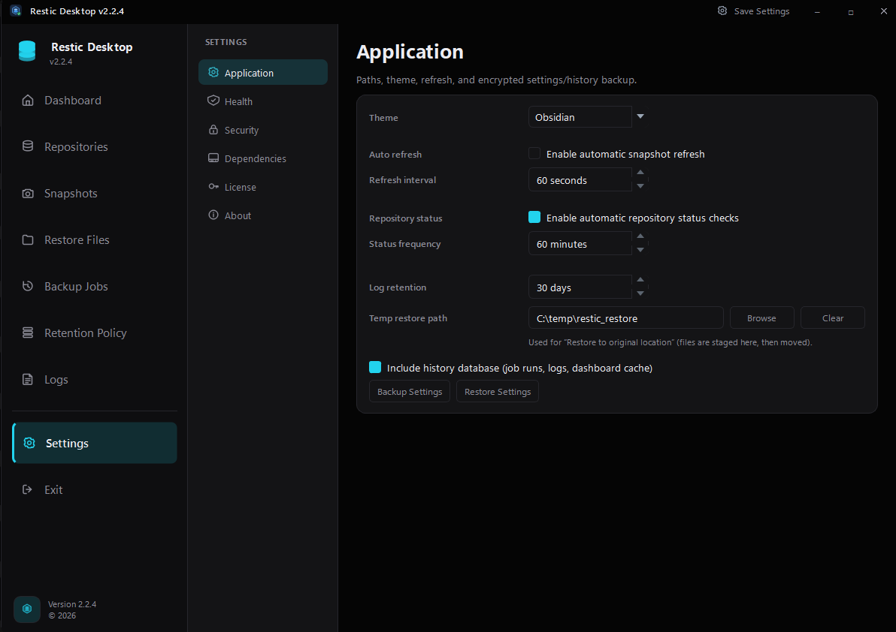

# Restic Desktop

A free, open-source [PySide6](https://doc.qt.io/qtforpython/) desktop application for managing [restic](https://restic.net/) backups: repositories, scheduled jobs, restores, retention, and repository health — without living in the CLI.

**Version:** 2.2.4  
**License:** [MIT](LICENSE) (your contributions welcome)

**Tested** Windows 11 / Ubuntu 26.04

If this app saves you time, you can [Buy Me a Coffee](https://buymeacoffee.com/dallustallus).

**User guide:** [Getting started](DOCS/GETTING_STARTED.md) — install, first repository, backup job, and a test restore.









---

## Features

### Repositories
- Local folders, **network shares** (UNC), **SFTP**, **Cloud** (OneDrive, Google Drive, Dropbox, S3, B2, and more via rclone), and **HTTPS** REST server
- Encrypted repository passwords at rest (machine-bound Fernet key)
- Connection status and last-checked metadata
- Integrity checks (quick / partial / full) and index rebuild helpers
- Copy snapshots between repositories (see [HTTPS copy limitation](#https-copy-limitation))

### Backup jobs
- Saved jobs with paths, tags, excludes, compression, pack size, and related options
- Multi-repository targets for redundancy
- `--skip-if-unchanged` by default (no empty snapshots when nothing changed)
- Guided backup wizard plus an advanced job editor
- Windows Task Scheduler integration (PowerShell scripts + DPAPI-protected passwords)
- Cron / LaunchAgent paths for Linux and macOS retention (and CLI job runs)

### Restore and browse
- Restore from a chosen snapshot to a folder or original paths
- Snapshot file browser with checkboxes for multi-select (no Ctrl/Shift required)
- Search across snapshots
- Guided restore wizard

### Retention
- Keep last / hourly / daily / weekly / monthly / yearly rules
- Dry-run preview and apply (`forget` + `prune`)
- Optional system-scheduled retention tasks

### Dashboard, health, and history
- Storage and snapshot charts
- Health scoring using successful job runs (including skip-unchanged), not only newest snapshot age
- Append-only SQLite history (`restic_history.db`): job runs, logs, dashboard cache
- Settings stay in JSON; history stays in SQLite

### Application
- Themes and optional startup password
- Encrypted backup/restore of settings **and** optional history database
- Activity log with level colouring and filters
- Windows toast notifications for completed backups (optional `winotify` for GUI runs)

---

## Download and run (binary release)

1. Get the latest build from [GitHub Releases](https://github.com/Dallustallus/restic-desktop/releases).
2. Run the executable (Windows: `ResticDesktop.exe`).
3. Install [restic](https://restic.net/) if needed, or use **Settings → Dependencies** in the app.
4. For **Cloud** repositories, also install [rclone](https://rclone.org/downloads/) and set it under **Settings → Dependencies**.

You do **not** need Python or PySide6 to use a release build. Then follow [Getting started](docs/GETTING_STARTED.md).

---

## Develop from source

For contributors and anyone running or packaging from the repo:

| Dependency | Notes |
|------------|--------|
| **Python 3.10+** | Developed and tested with recent 3.x |
| **PySide6** | UI (official Qt for Python; LGPL) |
| **cryptography** | Encrypting repository passwords in settings |
| **restic** | [Install from restic.net](https://restic.net/) or via Settings → Dependencies |
| **rclone** | Required for Cloud repositories; [rclone.org](https://rclone.org/downloads/) or Settings → Dependencies |
| **winotify** (optional) | Windows toast notifications for GUI-initiated backups |

Python packages are listed in `requirements.txt`.

```powershell
python -m venv env
.\env\Scripts\Activate.ps1
pip install -r requirements.txt
python restic_manager.py
```

### Building a standalone executable

Use the project PyInstaller spec so icons and the `icons/` folder are bundled:

```powershell
pyinstaller restic_manager.spec
```

Output: `dist/ResticDesktop.exe` (Windows) or `dist/ResticDesktop` (Linux).

Do not use a bare `pyinstaller --onefile restic_manager.py` for release builds — it skips the spec’s `datas` / icon settings.

---

## Data locations

Files are created in the application working directory (the folder you run from, or the folder next to a frozen executable):

| File / folder | Purpose |
|---------------|---------|
| `restic_settings.json` | Repositories, jobs, preferences |
| `restic_history.db` | Job runs, logs, dashboard cache |
| `scheduled_tasks/` | Generated Windows backup scripts and DPAPI password files |

Repository **data** lives at the restic repository path (local, SFTP, or REST URL), not inside this app.

**Portability note:** Encrypted passwords in settings use a machine-derived key. Moving `restic_settings.json` to another PC does not decrypt those passwords; re-enter them or use a fresh setup. Use **Settings → Backup Settings** (with history included if desired) when migrating intentionally.

---

## CLI helpers

```powershell
# Run a saved backup job (suitable for cron)
python restic_manager.py --run-job "My Job Name"

# Record a completed run into restic_history.db (used by Windows scheduled scripts)
python restic_manager.py --record-job-run "My Job Name" --repo-name "MyRepo" --duration 120 --success 1 --exit-code 0 --source scheduled
```

GUI backups, `--run-job`, and `--record-job-run` all write to the same history database and can append short entries to the Logs page.

---

## Repository backends

### Local
Pick a folder on disk or an external drive.

### Network share
Enter server, share, optional folder, username/password, and optional drive letter.
Enable **Connect only during backup / restore** so Windows mounts the share for the operation and disconnects afterward (helps keep backup storage offline from ransomware when idle). Works with GUI backups, health checks, and scheduled Task Scheduler scripts.

### SFTP
Host, port, username, remote path, and optional SSH private key. Restic expects **key-based** SSH login (not an interactive password prompt). Test connectivity with `ssh` before relying on scheduled jobs.

### Cloud
Choose a provider (OneDrive, Google Drive, Dropbox, S3, B2, Azure, Wasabi, or Other).
- **OneDrive / Google Drive / Dropbox / Other:** install **rclone** under Settings → Dependencies, use **Sign in** / **Refresh**, then set a backup location.
- **S3 / B2 / Azure / Wasabi:** enter bucket/container and access keys (native restic; rclone not required).

Consumer cloud (OneDrive / Google Drive / Dropbox) is convenient but can be slower and rate-limited compared with NAS or object storage.
Encrypted settings backup can include `rclone.conf` (cloud sign-ins) along with settings/history.

### HTTPS (REST server)
Available under Cloud → **REST server (HTTPS)**. Repository URL plus optional HTTP Basic Auth (anonymous, username + password, or password only). HTTP credentials are separate from the **repository password** that encrypts backup data.

### HTTPS copy limitation

Copying a snapshot between **two HTTPS repositories that use different HTTP Basic Auth credentials** is not fully supported by restic: only one `RESTIC_REST_USERNAME` / `RESTIC_REST_PASSWORD` pair is available for both sides. Copy still works when only one side needs HTTP auth, both sides share the same credentials, or either side is local/SFTP.

---

## Project layout

```
restic_manager.py       Main application
core/                   History DB and non-UI helpers
ui/                     Pages, themes, dialogs, charts
docs/                   End-user guides (getting started)
icons/                  Application and toolbar assets
scheduled_tasks/        Generated Windows schedule scripts (created at runtime)
requirements.txt
restic_manager.spec     PyInstaller build spec
LICENSE                 MIT license for this project
```

---

## Scheduling notes

- **Windows backup jobs:** Task Scheduler runs a generated PowerShell script that invokes restic, then briefly calls `--record-job-run` to log duration and success.
- **Multi-repo jobs:** A scheduled task currently backs up to the **first** selected repository only.
- **Retention schedules:** Can be created from the Retention Policy page (Windows tasks; Linux/macOS helpers as documented in-app).

---

## Troubleshooting

| Symptom | What to check |
|---------|----------------|
| Restic not found | Settings → Dependencies, or install from https://restic.net/ |
| Backup fails with “locked” | Unlock from the repository actions; interrupted runs can leave locks |
| Wrong or missing history | Confirm `restic_history.db` is writable next to settings; scheduled scripts must reach `python` / the app path |
| Empty “no change” snapshots | Ensure jobs use **Skip snapshot if unchanged** (default for new jobs); re-save Windows schedules so scripts pick up the flag |

Application messages appear on the **Logs** page (filterable by Errors / Warnings).

---

## License and third-party notices

- **Restic Desktop** source code is released under the [MIT License](LICENSE).
- **PySide6 / Qt** are used under their LGPL terms (see the Qt Company / PySide6 documentation).
- **restic** is separate software under its own license — see [restic.net](https://restic.net/).

This project is free to use. No activation key is required.
